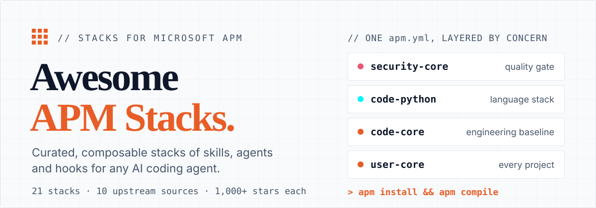
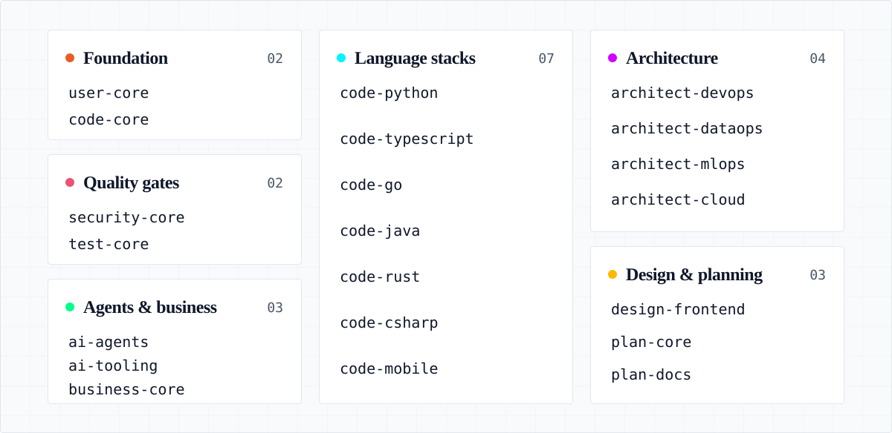
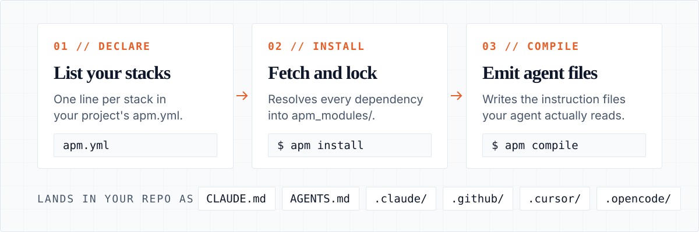

<p align="center">
  
</p>

# Awesome (Agent Package Manager) APM Stacks

[](LICENSE)
[](#packages)
[](#dependency-sources)
[](https://github.com/sponsors/thinkjones)

**21 ready-made stacks for [APM (Agent Package Manager)](https://microsoft.github.io/apm/).** Add one line to your `apm.yml` and your AI coding agent gets a vetted set of skills, agents, hooks and instructions — the same set for every teammate, whether they use Claude Code, Copilot, Cursor or OpenCode.

APM is an open-source project hosted under Microsoft's OSS org, created and maintained by [Daniel Meppiel](https://github.com/danielmeppiel). Think `npm` for everything that configures an AI agent. This repo curates the stacks we run on top of it; every upstream dependency comes from a repo with 1,000+ GitHub stars.

Website: [awesome-apm-stacks.foursignals.dev](https://awesome-apm-stacks.foursignals.dev)

## Quick start

```bash
# 1. Install APM (macOS / Linux)
curl -sSL https://aka.ms/apm-unix | sh
# or: brew install microsoft/apm/apm

# 2. From your project root, add the baseline stack
apm install thinkjones/awesome-apm-stacks/user-core

# 3. Emit the files your agent reads
apm compile
```

Step 2 writes `user-core` into your project's `apm.yml` and caches it under `./apm_modules/`. Step 3 generates `CLAUDE.md`, `AGENTS.md` and the target-specific config for whichever agent your repo uses. Commit `apm.yml` and every teammate who runs `apm install` gets the same setup.

See the [APM docs](https://microsoft.github.io/apm/) or the [APM GitHub repo](https://github.com/microsoft/apm) for other install options.

## Packages

<p align="center">
  
</p>

Start with `user-core`, add `code-core` for engineering quality gates, then layer language stacks and domain bundles per project. Each package directory holds one `apm.yml` and one `README.md` listing its upstream dependencies.

| Package | Concern | When to use |
| --- | --- | --- |
| [`user-core`](user-core/) | Context engineering, skill discovery, hallucination verification, devil's-advocate review, CLAUDE.md management, recurring task automation | Every project |
| [`code-core`](code-core/) | TDD enforcement, code review, PR review toolkit, git/commit workflows, semantic code search (serena), feature-dev, API architecture. Includes `user-core`. | Every coding project |
| [`code-python`](code-python/) | Python, FastMCP, pytest, debugging | Per stack |
| [`code-typescript`](code-typescript/) | TS/Node, React, NestJS, TS MCP SDK | Per stack |
| [`code-go`](code-go/) | Go, go-sdk MCP, debugging | Per stack |
| [`code-java`](code-java/) | Java, Spring Boot, Maven/Gradle, Java MCP servers | Per stack |
| [`code-rust`](code-rust/) | Rust, systems programming, cargo, Rust MCP servers | Per stack |
| [`code-csharp`](code-csharp/) | C#/.NET, ASP.NET, C# MCP servers | Per stack |
| [`code-mobile`](code-mobile/) | Flutter, Swift, Kotlin, mobile MCP servers | Per stack |
| [`architect-devops`](architect-devops/) | Docker, CI/CD, Terraform, incident triage | Most projects |
| [`architect-dataops`](architect-dataops/) | PostgreSQL, SQL, CSV analysis, data pipelines | When data-heavy |
| [`architect-mlops`](architect-mlops/) | LLM observability, eval pipelines, Arize | When ML involved |
| [`architect-cloud`](architect-cloud/) | Azure/AWS IaC, serverless, cost optimization | Cloud deployments |
| [`security-core`](security-core/) | OWASP, secure coding, vulnerability scanning, agent safety | Most projects |
| [`test-core`](test-core/) | E2E, integration testing, Playwright, polyglot test agents | Most projects |
| [`design-frontend`](design-frontend/) | UI/UX, React design, theming, accessibility | Frontend projects |
| [`plan-core`](plan-core/) | PRD, requirements, epics, QA, task breakdown | Most projects |
| [`plan-docs`](plan-docs/) | docx/pdf/pptx/xlsx, co-authoring, brand, comms | When producing docs |
| [`ai-agents`](ai-agents/) | Agent swarms, orchestration, MCP builder, LangGraph/LangChain observability | When building agents |
| [`ai-tooling`](ai-tooling/) | Meta-tooling for APM package authors — retrofit existing skills/plugins repos into APM-compliant packages | When authoring or maintaining APM packages |
| [`business-core`](business-core/) | Business workflow tooling | When needed |

Install any of them on its own with `apm install thinkjones/awesome-apm-stacks/<package>`.

These 21 packages are **one developer's opinion** of how to slice the AI-coding-agent space into composable bundles. They are illustrative, not definitive.

> **Got a different take?** Built a package for a domain not covered here — game dev, embedded, scientific computing, fintech? **Open a pull request** ([see Contributing](#contributing)). The whole point of APM is that there shouldn't be one canonical answer.

## Compose a project

List the stacks a project needs in its `apm.yml`:

```yaml
# apm.yml
name: my-project
version: 1.0.0

dependencies:
  apm:
    - thinkjones/awesome-apm-stacks/code-core
    - thinkjones/awesome-apm-stacks/code-python
    - thinkjones/awesome-apm-stacks/ai-agents
```

Then run:

```bash
apm install
apm compile
```

Packages are cached at `./apm_modules/` (gitignored, like `node_modules/`). Primitives are staged into `.claude/`, `.github/`, `.cursor/` or `.opencode/` — whichever your project uses.

Two reference manifests show full compositions:

- [`examples/fullstack-saas/`](examples/fullstack-saas/) — Go API + React frontend + ML features (composes 10 packages)
- [`examples/python-saas/`](examples/python-saas/) — LangGraph news digest SaaS with Python agents (composes 7 packages)

### Pin a version

Each release is tagged `<package>/v<version>`. Pin a package by appending the tag:

```bash
apm install thinkjones/awesome-apm-stacks/code-core#code-core/v0.0.2
```

### Customize a package

Every package is a short `apm.yml` listing dependencies. To tailor one for your team:

1. Fork or copy the package directory
2. Open `apm.yml` and comment out (or remove) dependencies you don't want
3. Add any additional dependencies your team needs
4. Share the customized package across your org

### Build your own org package

Wrap your team's choices in an internal package that depends on awesome-apm-stacks packages plus your private skills. Every project's `apm.yml` then lists that one package:

```yaml
# my-team-standards/apm.yml
name: my-team-standards
version: 1.0.0
description: Internal coding standards for Acme Corp

dependencies:
  apm:
    - thinkjones/awesome-apm-stacks/user-core
    - thinkjones/awesome-apm-stacks/code-typescript
    - thinkjones/awesome-apm-stacks/security-core
    # Add your own internal skills:
    # - your-org/internal-skills/api-conventions
    # - your-org/internal-skills/review-checklist
```

### After install

Run `agentrc` to generate project-specific `.instructions.md` from your actual codebase. Add your own `coding-principles.instructions.md` for TDD/BDD/DRY/YAGNI enforcement:

```markdown
# .github/instructions/coding-principles.instructions.md
---
applyTo: "**/*.py,**/*.go,**/*.ts"
---
- TDD: Write failing test first. No production code without a test.
- BDD: Use Given/When/Then for acceptance criteria.
- DRY: Extract shared logic. Flag duplication in review.
- YAGNI: Do not build speculative features.
- Single Responsibility: One reason to change per module/function.
- Fail fast: Validate inputs at boundaries. Return errors early.
```

## How APM works

<p align="center">
  
</p>

1. `apm install` fetches packages and caches them in `apm_modules/` (per project) or `~/.apm/` (user/global).
2. `apm compile` turns those staged assets into the instruction file your agent reads: `AGENTS.md` for Copilot, VS Code and OpenCode, `CLAUDE.md` for Claude Code, plus target-specific config in `.github/`, `.claude/` and so on.

APM detects which agent you use from the folders in your repo. Change agents, re-run `apm compile`, and the same `apm.yml` emits the new format.

### Why this matters

Every coding agent loads context its own way. Claude Code reads `CLAUDE.md` and `.claude/`. Copilot reads `AGENTS.md` and `.github/`. Cursor reads `.cursorrules` and `.cursor/`. OpenCode wants `.opencode/`. Meanwhile the artifacts engineers want — TDD enforcers, code reviewers, security scanners, MCP integrations — live scattered across hundreds of GitHub repos, each tied to one runtime.

APM packages whatever follows the open specs that exist today: [Agent Skills](https://agentskills.io) for skills, [AGENTS.md](https://agents.md) for instructions (stewarded by the [Linux Foundation's Agentic AI Foundation](https://lfprojects.org)), and [MCP](https://modelcontextprotocol.io) for tool servers. Author a primitive once in the standard format, declare it in `apm.yml`, and `apm compile` emits the right shape for the agent you target.

For a team that means:

- **Reproducible** — `git clone && apm install` gives every developer the same agent setup.
- **Portable** — switch from Claude Code to Copilot to Cursor without rewriting a skill.
- **Composable** — small focused packages combine via transitive dependencies, like npm.
- **Versioned** — pin versions, commit lock files, audit history.
- **Scanned on install** — `apm install` scans for hidden Unicode and compromised packages before your agent reads them.

<details>
<summary><strong>What APM manages</strong> — the seven primitive types</summary>

| Primitive | What it is | When it's loaded | Example |
| --- | --- | --- | --- |
| **Instructions** | Rules and conventions that shape every response — coding style, project context, hard constraints. | Once at session start, persists in the agent's system context for the whole conversation. | "Use TDD. Validate inputs at boundaries. Never log secrets." |
| **Skills** | Bundled capabilities following Anthropic's [Agent Skills](https://agentskills.io) standard — progressive disclosure keeps your context window lean. | Skill *names* are visible at session start; the full skill body loads only when the agent decides it's relevant. | A `pdf-generator` skill that loads only when someone asks for a PDF. |
| **Agents** | Specialised sub-agents with their own scoped tools, prompts, and context window. | On-demand — invoked as a tool call by the main agent (or directly by the user). Their context isn't shared with the parent. | A `code-reviewer` agent that runs after edits, or a `tdd-guide` agent for new features. |
| **Hooks** | Shell commands triggered by lifecycle events (pre-tool, post-tool, on-stop) — enforced by the harness, not the agent. | Around every tool call or session event. Never enters the agent's context window — they just run. | Block `git push --force` on `main`, or run the formatter after every edit. |
| **MCP servers** | External tool servers via the [Model Context Protocol](https://modelcontextprotocol.io) — give the agent typed access to APIs, databases, file systems. | Tool definitions registered at session start; tool *responses* arrive per-call, only when the agent invokes one. | A Postgres MCP server that lets the agent run read-only SQL against staging. |
| **Prompts** | Reusable slash commands — parameterised templates you invoke with `/name`. | Only when the user explicitly invokes them — never automatically. | `/review-pr 1234` expands into a structured PR-review prompt. |
| **Plugins** | Bundles that group several of the above into one installable unit. | Per the primitives inside. | A `pr-review-toolkit` plugin shipping a code-reviewer agent + commit hooks + a `/review-pr` prompt. |

</details>

<details>
<summary><strong>APM scopes</strong> — user, project, organisational, temporary</summary>

APM has **two native scopes** (user and project), plus two workflow patterns most teams build on top:

| Scope | How | Where it lands | When to use |
| --- | --- | --- | --- |
| **User (global)** | `apm install -g <pkg>` | Cache: `~/.apm/` · Primitives: `~/.claude/`, `~/.copilot/`, `~/.cursor/`, `~/.config/opencode/` | Rarely useful in practice — teams are better served by project-scope installs that ship with the repo. Reach for `-g` only for personal tooling you want available outside any project (e.g. ad-hoc skill authoring). |
| **Project** | `apm install` from a project root with an `apm.yml` | Cache: `./apm_modules/` (gitignored) · Primitives: `./.claude/`, `./.github/`, etc. | Stack- and team-specific deps that ship with the repo. Every clone gets the same setup. |
| **Organisational** | Publish an internal APM package (e.g. `acme-corp/standards`) and list it in each project's `apm.yml` | Pulled in *as a project dep* — but maintained centrally and versioned across the org | Company-wide engineering standards, internal review checklists, security policies. |
| **Temporary** | `apm install <pkg>` in a throwaway dir or git worktree without committing | Local only, never reaches the project's `apm.yml` | Trying a package out before committing, or running a one-off task with extra skills. |

Local files always win: anything in your project overrides what's installed, and project-scope deps override user-scope deps with the same name.

</details>

## Got an existing skills repo? Make it APM-compliant

If you maintain a skills repo, a Claude/Copilot/Cursor plugin, a collection of `.agent.md` files, or any other agent-facing bundle, you can turn it into an APM package so consumers can pull it with `apm install owner/repo`.

APM ships `apm init`, but it is deliberately minimal — it drops a stub manifest without looking at what is in your repo. The [`ai-tooling`](ai-tooling/) package fills that gap with an `apm-retrofit` skill that walks your repo, classifies every primitive (SKILL.md, plugin.json, AGENTS.md, MCP manifests, hooks, commands, sub-agents, instructions, chatmodes), and proposes a correctly-shaped `apm.yml` for you to review and commit.

```bash
# 1. Install APM (once per machine)
curl -sSL https://aka.ms/apm-unix | sh

# 2. From inside the repo you want to retrofit, pull ai-tooling
#    as a project dep and compile so your agent picks up the skill:
apm init -y                                           # only if no apm.yml yet
apm install thinkjones/awesome-apm-stacks/ai-tooling
apm compile

# 3. In your agent (Claude Code, Copilot, etc.), invoke:
#      "Use apm-retrofit to make this repo APM-compliant"
#    (or run /apm-retrofit as a slash command)
```

The skill reports what it found, shows you the proposed `apm.yml`, diffs it against any existing manifest, and only writes the file after you confirm. It never deletes existing files, and it runs `apm install --dry-run` against the result so you know the manifest is valid before you commit it.

Full details: [`ai-tooling/.apm/skills/apm-retrofit/SKILL.md`](ai-tooling/.apm/skills/apm-retrofit/SKILL.md).

## Workflows and wrappers

Two directories sit beside the 21 packages:

- [`workflows/`](workflows/) holds task-shaped bundles that combine skills with the MCP servers they need. The first is [`website-ui-ux-with-stitch`](workflows/website-ui-ux-with-stitch/), a Google Stitch website-design workflow.
- [`wrappers/`](wrappers/) holds generated packages that track an upstream skills monorepo. A `wrapper.yml` names the upstream repo and a glob pattern; `scripts/generate-wrappers.py` discovers the matching skills and writes one dependency line per skill. [`code-core`](code-core/) consumes the [`mattpocock/skills`](wrappers/github.com/mattpocock/skills/) wrapper.

## Dependency sources

All dependencies are drawn from well-maintained repositories. Star counts are approximate and were recorded when each package was added.

| Source | Stars | Used by |
| --- | --- | --- |
| [obra/superpowers](https://github.com/obra/superpowers) | 140K+ | [`code-core`](code-core/) |
| [anthropics/skills](https://github.com/anthropics/skills) | 112K+ | [`ai-agents`](ai-agents/), [`user-core`](user-core/), [`plan-docs`](plan-docs/), [`test-core`](test-core/), [`design-frontend`](design-frontend/) |
| [ComposioHQ/awesome-claude-skills](https://github.com/ComposioHQ/awesome-claude-skills) | 51K+ | [`architect-dataops`](architect-dataops/), [`business-core`](business-core/), [`code-python`](code-python/) |
| [github/awesome-copilot](https://github.com/github/awesome-copilot) | 28K+ | [`ai-agents`](ai-agents/), [`architect-dataops`](architect-dataops/), [`architect-devops`](architect-devops/), [`architect-mlops`](architect-mlops/), [`architect-cloud`](architect-cloud/), [`code-core`](code-core/), [`code-csharp`](code-csharp/), [`code-go`](code-go/), [`code-java`](code-java/), [`code-mobile`](code-mobile/), [`code-python`](code-python/), [`code-rust`](code-rust/), [`code-typescript`](code-typescript/), [`user-core`](user-core/), [`plan-core`](plan-core/), [`security-core`](security-core/), [`test-core`](test-core/), [`design-frontend`](design-frontend/) |
| [vercel-labs/agent-skills](https://github.com/vercel-labs/agent-skills) | 24K+ | [`design-frontend`](design-frontend/) |
| [anthropics/claude-plugins-official](https://github.com/anthropics/claude-plugins-official) | 16K+ | [`user-core`](user-core/), [`code-core`](code-core/), [`ai-agents`](ai-agents/), [`design-frontend`](design-frontend/) |
| [vercel-labs/skills](https://github.com/vercel-labs/skills) | 13K+ | [`user-core`](user-core/) |
| [mattpocock/skills](https://github.com/mattpocock/skills) | 13K+ | [`code-core`](code-core/) (via wrapper), [`plan-core`](plan-core/) |
| [nizos/tdd-guard](https://github.com/nizos/tdd-guard) | 1.9K+ | [`code-core`](code-core/) |
| [supabase/agent-skills](https://github.com/supabase/agent-skills) | 1.8K+ | [`architect-dataops`](architect-dataops/), [`architect-cloud`](architect-cloud/), [`code-python`](code-python/) |

## Testing

The test suite validates every APM package manifest in the repository:

1. **YAML syntax** — each `apm.yml` is parsed with `python3`/`pyyaml` to catch syntax errors
2. **Dependency resolution** — `apm install --dry-run` verifies all declared dependencies can be resolved (skipped if the `apm` CLI is not installed)

```bash
./scripts/test-packages.sh                          # all packages
./scripts/test-packages.sh code-python code-go      # specific packages
./scripts/test-packages.sh --ci                     # no colours, same exit codes (used by GitHub Actions)
```

> **Note:** The script requires `python3` with the `pyyaml` package (`pip install pyyaml`). If the `apm` CLI is not installed, dry-run checks are skipped with a warning.

Tests run automatically via GitHub Actions (`.github/workflows/test-packages.yml`):

- **On push to main** — tests only the packages whose files changed
- **Daily (6 AM UTC)** — runs all package tests if there were commits in the last 24 hours, or on Mondays as a weekly sweep
- **Manual** — trigger from the Actions tab; optionally specify packages

## About this repo

### Contributing

Pull requests are welcome — especially new packages for under-served domains.

- Follow existing structure: one directory, one `apm.yml`, one `README.md`
- All dependencies must come from repos with 1,000+ GitHub stars
- Run `./scripts/test-packages.sh --ci` before submitting
- **Bump the `version:` in every package you touch** (see [Versioning](#versioning))
- Open an issue first if you want to discuss a new package idea

### Versioning

Each package carries its own semver in `apm.yml`. When you change files inside a package directory, you must bump that package's version in the same PR — CI rejects PRs that modify a package without a version bump.

Pick the bump type yourself:

- **Patch** (`0.1.3 → 0.1.4`) — bug fix, doc tweak, no behaviour change for consumers
- **Minor** (`0.1.3 → 0.2.0`) — additive change (new dep, new primitive, additional option)
- **Major** (`0.1.3 → 1.0.0`) — breaking change (removed dep, renamed primitive, incompatible option)

Helper script:

```bash
./scripts/bump-version.sh ai-agents patch
./scripts/bump-version.sh code-python minor
./scripts/bump-version.sh architect-cloud major
```

On merge to `main`, the release workflow detects each package whose version increased and publishes a `<package>/v<version>` tag plus a GitHub Release. The release workflow itself makes no commits. The only automated commits on `main` come from the weekly wrapper regeneration (`.github/workflows/update-wrappers.yml`), and only when an upstream skills repo has changed.

### A note on `docs/internal/`

`docs/internal/` is a [git submodule](https://git-scm.com/book/en/v2/Git-Tools-Submodules) pointing at a private repo that holds archived design briefs. Cloning this repo leaves the path empty — that's expected and nothing you need for contributing or using the packages. Ignore it and carry on.

### Author

**Gene Conroy-Jones** — PhD in Civil Engineering (Cardiff University). Startup CTO across 7 startups at seed through Series B, including 2 acquisitions (Salesforce, Stanley Black & Decker) and raising $35M in Series B funding. Now focused on AI transformation of engineering organisations.

Blog: [foursignals.dev](https://foursignals.dev)

Open to full-time roles, fractional CTO engagements, and advisory positions — [get in touch](https://foursignals.dev).

### License

MIT — see [LICENSE](LICENSE) for details.
